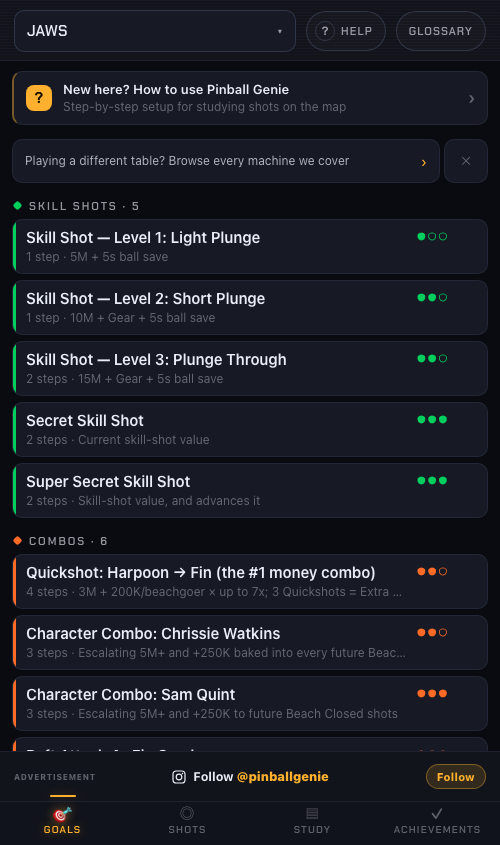
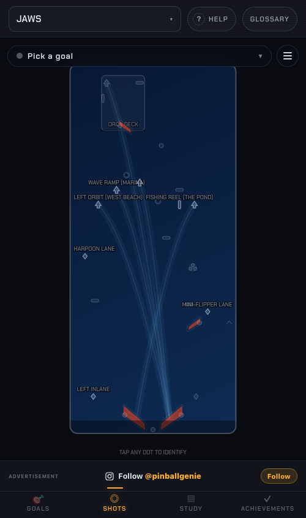
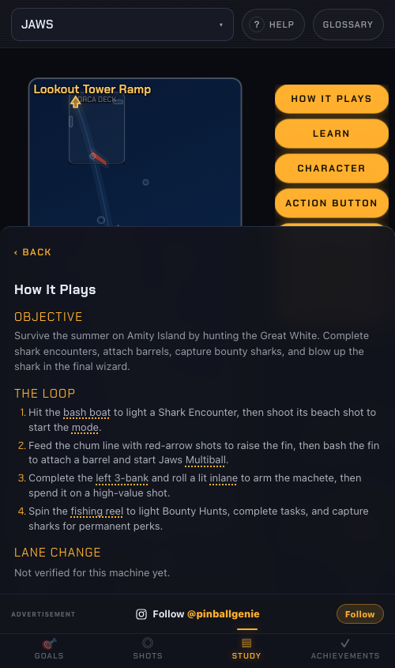
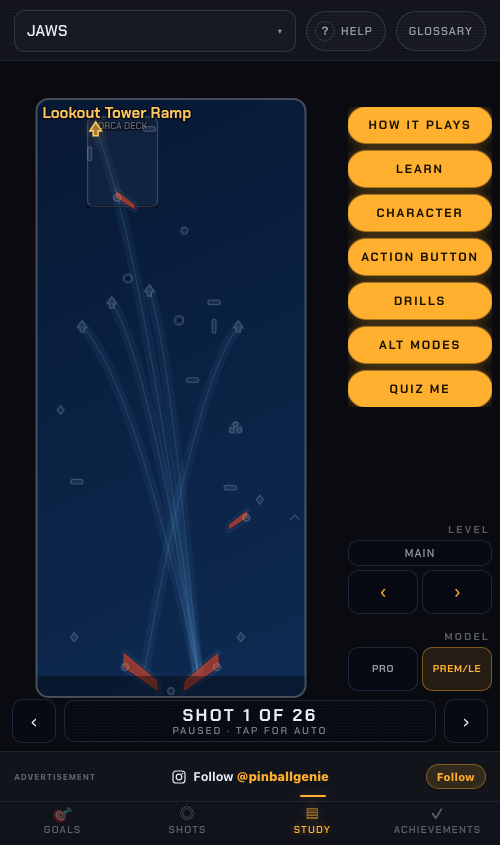

# Pinball Genie Web

[](LICENSE) [](data/LICENSE.md) [](https://pinball-genie.com)

The public web app at **https://pinball-genie.com** — a pinball *study* tool.
Pick a machine, read what its goals actually are, see where the shots are on a
2D playfield map, and step through the whole playfield before you play. Vanilla
TypeScript on Vite, no framework; a stdlib-only Python 3 server in front of it.


**Intended use:** everything here is for *before and after* a game, never during
one. Nothing in the app assumes a phone is held up while a ball is in play —
there is no score entry, no ball tracking, and no live camera.

Read `CONTRACTS.md` for the module boundary map and shared interfaces, and
`app/src/models.ts` for the canonical data types (the TS doc comments there are
the prose authority for the dataset schema). `CONTRACTS-PLAYFIELDS.md` covers
the playfield/deck half of that schema.

## Screenshots

| Goals | Shots map | How it plays | Study |
| --- | --- | --- | --- |
|  |  |  |  |

## About this repository

This is the complete source of the production site, published as a portfolio
project. It is built and tested here exactly as it is deployed; the only
differences from the private working tree are:

- the per-machine `sources` arrays in `data/*.json` are emptied here;
- deploy defaults (droplet address, key path) are placeholders — set
  `PG_DROPLET` / `PG_KEY` yourself;
- internal audit notes and design handoff material are not included.

Every goal description, how-it-plays sheet and playfield diagram is original
instructional text and schematic art written for this app, informed by publicly
documented rules and the author's own play.

## What the app is

Four tabs, and that's the whole surface:

| Tab | What it does |
| --- | --- |
| **Goals** | The machine's goals, by category and tier — tap one for step-by-step guidance. |
| **Shots** | The 2D playfield map: shots, drawn routes, the plunge gauge, a MODEL (trim) selector. |
| **Study** | A step-through of everything on the playfield — no goal, no route, no timer. |
| **Achievements** | Progress tracking. The one feature that needs an account. |

Alongside the SPA the site serves static, JS-free pages: per-machine guide pages
under `/machines/**` (generated at build time — this is the site's SEO surface)
and the legal/marketing pages `/privacy`, `/terms`, `/about`, `/contact` from
`server/legal/`.

**Accounts are optional and exist only for Achievements.** There is no password
anywhere in this system: you type an email, and you get back a one-time sign-in
link *and* an 8-character code that does the same thing (the code is there for
the installed-PWA case, where the link can't hand a cookie back to the right
browser). The SPA, `/data/*.json`, the guide pages and the legal pages are all
public with no session. Only `/whoami`, `/api/achievements`, `GET /auth/export`
and `POST /auth/delete` are session-gated. See `server/pinball_auth.py`'s module
docstring for the full model — read it before touching that file.

**Durable copy never claims a machine count.** Not in the README, not in meta
descriptions, not in page dek copy, not in code comments that outlive the
number. The catalog moves; a count in prose goes stale silently and is the kind
of claim a stranger can check.

## Layout

```
PinballGenieWeb/
  data/                    the dataset — source of truth, plain JSON
    <machine>_goals.json     one file per machine (goals, shots, decks, drills…)
    catalog.json             which machines the app actually loads
    guides.json              prose for the /machines/** guide pages
    glossary.json            shared term definitions
  app/                     Vite + vanilla-TS SPA
    src/
      main.ts app.ts state.ts models.ts styles.css   shell, state, types
      overlay/               2D playfield map + route drawing (map2d, shotgeom)
      ui/                    every tab surface + chrome (study, achievements, …)
      ar/ identify/ fx/      COLD STORAGE — see below
    scripts/
      gen-guides.mjs         builds /machines/** + sitemap.xml (runs on prebuild)
      run-tests.mjs          the test gate
      validate-machines.py   structural validator for data/
      register-machine.py    adds a machine to catalog.json
    tests/                   *.test.mjs suites
  server/
    pinball_auth.py          stdlib-only Python 3 HTTP server behind Caddy
    mail_sender.py           Resend / dev-log sender for sign-in mail
    login.{html,css,js}      the sign-in page
    legal/                   privacy, terms, about, contact + their stylesheet
    tests/                   live-subprocess server suite
    pinball-auth.service     systemd unit
  deploy-prod.sh           PRODUCTION deploy — the only supported path
```

### Cold storage (`app/src/ar`, `app/src/identify`, `app/src/fx`)

Web AR and auto machine-ID were removed on 2026-07-29; `ui/machinecard.ts` was
retired on 2026-08-11. Those files were **not deleted** — they follow this
repo's **UNIMPORT pattern**: the module stays on disk, fully typechecked, with
zero import edges into anything that ships. `app/src/app.ts`'s header comment is
the authoritative log of what went cold and when.

Two consequences worth knowing before you "clean up":

- `tsconfig.json` still typechecks these files, so `tesseract.js` and
  `@techstark/opencv-js` remain installed — as **devDependencies**, since
  nothing in `dist/` references them. See `app/VENDOR-REMOVED.md`.
- Types in `models.ts` that only cold-storage code uses are kept deliberately.
  They say so in their own doc comments.

## Dev loop

```sh
cd app
npm install          # first time
npm run build        # prebuild regenerates /machines/**, then vite build -> app/dist
cd ..
python3 server/pinball_auth.py --dev --root app/dist --data data
# -> http://127.0.0.1:9310/
```

`--dev` drops the cookie's `Secure` flag (so sign-in works over plain `http://`)
and uses an ephemeral session secret (sessions don't survive a restart). With no
`PINBALL_PUBLIC=1`, a dev server runs *gated* — the staging default — so `/` will
redirect you to `/login`; set `PINBALL_PUBLIC=1` to match the production unit.
Sign-in mail falls back to a dev sender that logs the link instead of sending it.

`npm run dev` gives you Vite's dev server, but note it serves the SPA only — no
auth routes, no `/data`, no guide pages.

## Gates

Run all three before you ship anything. Each is judged on its own exit code —
never on the tail of a pipeline (`runner | grep` reports *grep's* status, which
is how a failing check once rode along on a green deploy).

```sh
cd app
npm run typecheck    # tsc --noEmit, strict
npm test             # every app/tests/*.test.mjs suite, via scripts/run-tests.mjs
npm run build        # prebuild (guide pages + sitemap) then vite build
```

The server has its own suite — a live `pinball_auth.py` subprocess driven over
real HTTP:

```sh
python3 server/tests/test_magic_link_auth.py
```

**Run it on Python 3.12+, not macOS's system `python3` (3.9).** The droplet runs
3.12, and version-specific behavior has produced false results here before:

```sh
uv run --python 3.12 -- python3 server/tests/test_magic_link_auth.py
```

The dataset has a structural validator (shot ids that don't exist, categories
the UI has no metadata for, coordinates outside the unit square, a machine in
`data/` with no catalog entry). It is **not** wired into the build — run it by
hand after touching `data/`:

```sh
python3 app/scripts/validate-machines.py     # exit 0 clean, 1 on any ERROR
```

## Deploying

**Production ships only via `./deploy-prod.sh`.** Written but never run
automatically — review it, then run it by hand.

It is self-gating: step (a0) runs `npm run typecheck` and `npm test` *before* the
build, so a type error or a red suite aborts the deploy in seconds instead of
being discovered in production; step (a1) then proves the guide pages actually
landed in `app/dist/machines/`, because a `scp -r` of a dist with no `/machines/`
in it would otherwise "succeed" while the entire SEO surface silently vanished.
There are further preflight checks (sourcemaps must be off, the Resend key must
exist on the droplet) and post-deploy smoke tests over real HTTPS.


## Notes for whoever operates this

- **CSP forbids inline style and script** (`style-src 'self'; script-src 'self'`,
  set in the Caddy block `deploy-prod.sh` writes). Every rule must live in a
  bundled `.css` file — no `<style>` blocks, no `style=""` attributes, no inline
  `<script>`. Per-instance dynamic values go through CSSOM property assignment
  instead. This constrains generated pages (`/machines/**`, the 404 page) as much
  as it does the SPA.
- **The service worker is network-first, never cache-first** (`app/public/sw.js`,
  2026-10-14). It exists for venue Wi-Fi: every shell / `/assets/*` /
  `/data/*.json` / font / icon request goes to the network, and the versioned
  cache is used only when the network fails or answers non-OK. Cache-first would
  boot a stale `index.html` whose hashed chunks `deploy-prod.sh` has already
  pruned. It never touches `/auth/*`, `/api/*`, `/whoami`,
  `/manifest.webmanifest` or non-GET requests. Bump `CACHE_VERSION` only when
  the worker's caching format changes, not per deploy. Tests:
  `app/tests/sw.test.mjs`.
- **The session secret is never in this repo** — it's generated on the droplet at
  first deploy and lives in `/etc/pinball-auth/`. Neither is the Resend API key.
  `server/auth.json` no longer exists in any form; passwords were retired when
  magic-link accounts landed.
- **Legal copy ships with the feature it describes.** Anything touching ads,
  analytics, AI applied to user data, uploads or payments updates
  `server/legal/privacy.html` + `terms.html` and bumps their effective date in
  the *same* deploy — never in a follow-up.

## Trademarks and non-affiliation

Pinball Genie is an independent study tool. It is not affiliated with, endorsed
by, or sponsored by Stern Pinball, Inc., Spooky Pinball LLC, Chicago Gaming
Company, Jersey Jack Pinball, Bally, Williams, Gottlieb, Sega, Data East, Capcom,
or any other pinball manufacturer or theme/franchise rights holder.

All machine names, manufacturer names and trademarks are the property of their
respective owners and are used here only nominatively — to identify the physical
machines this app provides study information for. Pinball Genie ships no
manufacturer artwork, logos, audio or game code; all overlays are original
schematic diagrams and all goal descriptions are original instructional text.

## License

- **Code** (everything outside `data/`): [GNU AGPL-3.0](LICENSE).
  © 2026 Pinball Genie LLC.
- **Dataset** (`data/`): [CC BY-NC-SA 4.0](data/LICENSE.md). Non-commercial use
  with attribution and share-alike; commercial use needs permission.
- Fonts: Chakra Petch, SIL Open Font License (`app/public/fonts/OFL.txt`).
